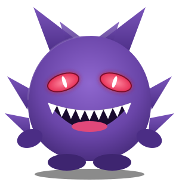

<div align="center">

VL — automação, dados e bots. Um Gengar flutua ao lado." width="100%" />

<br />

### 👻 &nbsp;`vl` · desenvolvedor de automações&nbsp; 💜

*"Se roda sozinho às 3 da manhã, provavelmente fui eu. Ou foi o Gengar."*

<br />




</div>

## 🔮 &nbsp;Sobre mim

```js
const vl = {
  nome: "vl",
  tema: ["preto", "roxo"],
  vive: "no terminal",
  faz: ["automações", "dados", "relatórios", "bots de WhatsApp"],
  pokemon: "Gengar 👻",
  modoEscuro: true,        // sempre
  dorme: () => "relatórios rodando sozinhos",
};
```

- 🕸️ &nbsp;Construo sistemas que **trabalham sozinhos**: coletam dado, cruzam, calculam e avisam.
- 🌙 &nbsp;Gosto de tudo que roda em segundo plano e só aparece quando precisa.
- 💬 &nbsp;Integro APIs, bancos de dados e WhatsApp para transformar processo manual em rotina automática.

<div align="center"></div>

## 🧪 &nbsp;Em construção

| | |
|---|---|
| 🟣 **Nexus** | plataforma própria de automação e acompanhamento de operação — relatórios, bots, régua de disparos e monitores em tempo real. *(repositório privado)* |

<div align="center"></div>

## 👻 &nbsp;Quem é esse Pokémon?

<table>
<tr>
<td width="240" align="center"></td>
<td>

**Gengar** &nbsp;·&nbsp; `#094`

- 🟣 Tipo **Fantasma / Veneno**
- 🌑 Mora nas sombras — e eu também, com o tema escuro ligado
- 😈 Habilidade: *Cursed Body* (o bug que some quando você olha para ele)
- 💜 Mascote oficial deste perfil

> 👀 Sentiu um calafrio agora? Foi ele.

</td>
</tr>
</table>

<br />


